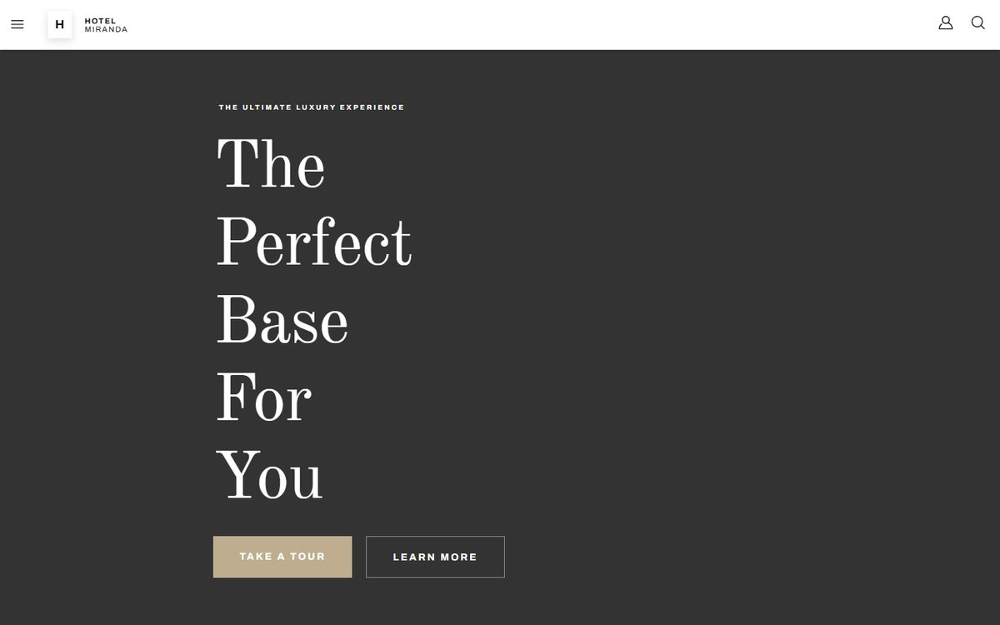
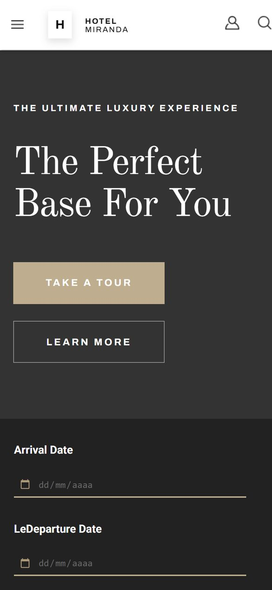

<div align="center">

# Hotel Miranda

**Web de un hotel de lujo maquetada desde cero con HTML semántico, SCSS y sliders con Swiper.**

Proyecto del Training React Full Stack de OXYGEN · Sprint 1


[**Ver demo**](https://albertocalerocastillo.github.io/OXYGEN_HotelMiranda/)

</div>

<p align="center">
  
  &nbsp;
  
</p>

## Qué es

Hotel Miranda es la web estática de un hotel ficticio, construida a partir de un diseño dado en el primer sprint del training. El objetivo era traducir un diseño a código fiel, con varias páginas enlazadas entre sí, primero en móvil y después adaptado a escritorio.

## Funcionalidades

- **Seis páginas enlazadas**: inicio, sobre nosotros, habitaciones, detalle de habitación, ofertas y contacto.
- **Menú hamburguesa** en JavaScript que despliega la navegación y cambia el icono de abrir a cerrar.
- **Ocho sliders con Swiper** (habitaciones, instalaciones, menú del restaurante, contadores, ofertas populares y habitaciones relacionadas), con flechas o paginación por puntos según la sección.
- **Formularios maquetados**: buscador de disponibilidad por fechas, reserva en el detalle de habitación y formulario de contacto (solo interfaz, sin envío).
- **Diseño mobile first** con adaptación a escritorio a partir de 1000 px en inicio, sobre nosotros y footer.

## Stack

| Capa | Tecnología |
| --- | --- |
| Estructura | HTML5 semántico (`header`, `main`, `section`, `footer`) |
| Estilos | SCSS compilado a CSS, con variables y mixins propios |
| Interacción | JavaScript vanilla |
| Sliders | [Swiper 11](https://swiperjs.com/) desde CDN |
| Tipografías | Archivo, Old Standard TT y Roboto (Google Fonts) |
| Despliegue | GitHub Pages |

## Estructura

```
OXYGEN_HotelMiranda/
├── index.html              # Inicio
├── pages/                  # aboutUs, rooms, roomsDetails, offers, contact
├── scripts/
│   ├── navbar.js           # Menú hamburguesa
│   └── slider.js           # Configuración de todos los Swiper
├── styles/
│   ├── styles.scss         # Punto de entrada (compila a styles.css)
│   ├── _variables.scss     # Colores
│   ├── _mixin.scss         # Estilos tipográficos reutilizables
│   ├── components/         # navbar y footer
│   └── pages/              # Un parcial por página
└── images/
```

## Puesta en marcha

No necesita instalación: es una web estática.

```bash
git clone https://github.com/albertocalerocastillo/OXYGEN_HotelMiranda.git
cd OXYGEN_HotelMiranda
# Abre index.html en el navegador o usa Live Server en VS Code
```

Para editar los estilos, compila el SCSS (por ejemplo con la extensión Live Sass Compiler o con Sass):

```bash
npx sass --watch styles/styles.scss styles/styles.css
```

## Qué aprendí

- A organizar el SCSS por componentes y páginas, con variables y mixins para no repetir tipografías ni colores.
- A nombrar clases con BEM (`bloque__elemento--modificador`) para que cada sección sea independiente.
- A trabajar mobile first y añadir media queries para escritorio solo donde el diseño lo pide.
- A integrar una librería externa como Swiper y configurar varias instancias distintas en la misma web.

---

<div align="center">

Hecho por [Alberto Calero](https://github.com/albertocalerocastillo)

</div>
